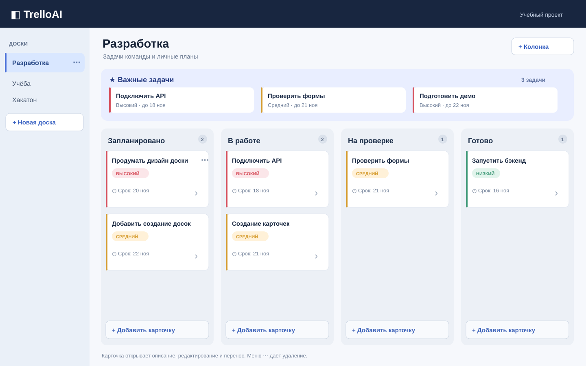

# Целевой интерфейс TrelloAI

Это согласованный ориентир для фронтенда. Макет показывает **одну открытую доску** на широком экране. Примерные названия задач служат только для демонстрации вида; настоящие данные приходят из API.

## Что должно работать

- Слева: список досок, выбор доски, создание новой и удаление доски через меню.
- Сверху: название открытой доски и блок из трёх важных задач из `GET /api/boards/{id}/focus`.
- В центре: колонки открытой доски и карточки внутри них. Колонок может быть больше четырёх; область доски прокручивается по горизонтали.
- Карточка кратко показывает название, приоритет и срок. Нажатие открывает подробности: описание, изменение названия, описания, срока и приоритета, выбор другой колонки для переноса и удаление карточки.
- В каждой колонке: создание карточки. Новые данные появляются после успешного ответа сервера без ручной перезагрузки страницы.
- Состояния загрузки, пустого списка и ошибки видны пользователю.

## Внешний вид

Светлый фон, тёмная верхняя панель, спокойные синие акценты. Колонки чуть темнее фона; карточки белые. Приоритет обозначен цветной полосой и **текстовой** меткой, чтобы смысл был понятен и без цвета. Основная ширина карточек и колонок фиксирована; на узком экране доска прокручивается горизонтально.

## Как реализуем без лишней сложности

Оставляем обычные кнопки, формы и выпадающий список для переноса. Drag and drop и сложные анимации не нужны для первой готовой версии. Сначала доводим основные действия с досками, колонками и карточками, затем полируем расположение, сообщения об ошибках и адаптивность. После этого покрываем важные сценарии тестами: загрузка досок, создание карточки, перенос и обработка ошибки API.

## Критерий готовности

Пользователь может создать доску и колонку, добавить карточку, увидеть её данные, изменить и перенести её, а также открыть важные задачи. После каждого успешного действия экран показывает актуальные данные без ручного обновления. Интерфейс остаётся понятным при пустых данных и при недоступном бэкенде.

## Границы текущего бэкенда

Макет закрывает пользовательские действия из существующих контроллеров: создание и удаление доски, создание колонки, создание, редактирование, перенос и удаление карточки, а также подборку важных задач. Отдельные `GET /api/cards` и `GET /api/tasklists` не требуют отдельных экранов: доска уже возвращает вложенные колонки и карточки. У бэкенда нет эндпоинтов редактирования или удаления колонки, поэтому такие кнопки в макет не включены. Подборка важных задач рассчитывается правилами по приоритету и сроку; вызова ИИ-модели в текущем бэкенде нет.
